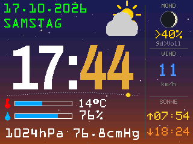
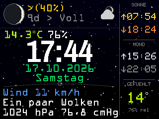
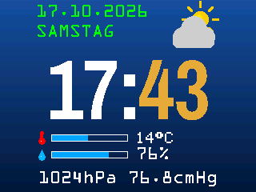
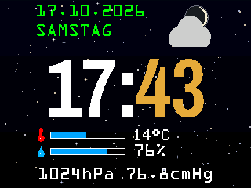
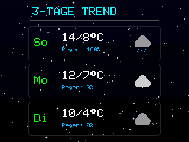
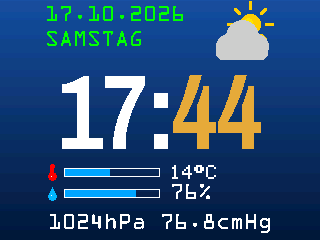

# ☁ ESPressWeather32

🇬🇧 [English](README.md) · 🇩🇪 **Deutsch**

Eine **Wetteranzeige für ESP32-Display-Boards** – eine Firmware für den **CYD** (ESP32-2432S028),
den **NM-TV-154** und den **MiniTV ESP32-C2**. Uhr, aktuelles Wetter, 3-Tage-Vorhersage, Mondphase und
eine Energie-Ansicht für eine Tasmota-Steckdose. Einrichtungs-Portal, Web-Dashboard und Einstellungen im Stil von
[ESPressMiner32](https://github.com/brenner23/ESPressMiner32) und [ESPressDuino](https://github.com/brenner23/ESPressDuino).
Keine Zugangsdaten im Quellcode.

🔗 **Projektseite:** https://github.com/brenner23/ESPressWeather32

 

   

*Bilder: vom Gerät selbst gerenderte Displaybilder (Debug-Vorschau, siehe unten), CYD im Querformat.*

## Unterstützte Geräte

| Gerät | Display | Stand |
|---|---|---|
| **CYD** ESP32-2432S028 | ST7789 240×320, XPT2046-Touch, Lichtsensor | ✅ Version 1.0, getestet |
| **NM-TV-154** (NerdMiner TV) | ST7789 240×240, Touch-Taste | 🔨 Version 1.0 baut, Gerätetest folgt |
| **MiniTV ESP32-C2** | ST7789 240×240, ein Kern | 🔨 Version 1.0 baut, Gerätetest folgt |

## Ansichten

| Ansicht | Inhalt |
|---|---|
| **Wetter 1** | Datum, Wochentag, große Uhr, Wetter-Icon, Balken für Temperatur und Feuchte, Luftdruck in hPa und cmHg |
| **Wetter 2** | Wie Wetter 1, dazu ein Sonnenbogen unter der Uhr (Sonne bzw. Mond wandert von Aufgang bis Untergang). Auf dem CYD zeigt die freie Fläche (quer rechts, hochkant unten) Mondphase, Wind und Sonnenauf-/-untergang |
| **Wetter 3** | Mondphase mit % und Tagen bis Voll-/Neumond, Icon, farbige Temperatur, Uhr, Datum, Wind, Beschreibung, Luftdruck. CYD-Zusatzfläche: Sonnen- und Mondauf-/-untergang, gefühlte Temperatur |
| **3 Tage** | Vorhersage für die nächsten drei Tage (Min/Max, Regenwahrscheinlichkeit) |
| **Energie** | Leistung, heute, gestern, gesamt einer Tasmota-Steckdose (per MQTT) und die Uhr |
| **Auto** | Wechselt die Ansicht alle N Sekunden |

**Himmel-Hintergrund auf allen Ansichten:** tagsüber blau, in der Dämmerung ein violett-oranger Schimmer, nachts Nachtblau mit Sternen.
Die Sterne blenden 30 Minuten nach Sonnenuntergang ein und 30 Minuten vor Sonnenaufgang aus – Sonnenauf- und -untergang kommen mit den
OpenWeather-Daten für deinen Ort. Nachts zeigt das Wetter-Icon den echten Mond mit seiner Phase, bei Wolken steht er dahinter.
Neu gezeichnet werden nur geänderte Bereiche (erst der Hintergrund-Ausschnitt, dann der Inhalt) – kein Flackern, die Sterne bleiben.

## Funktionen

- **Einrichtungs-Portal:** WLAN `ESPressWeather-XXXX` (Passwort `espressweather`), WLAN-Scan, alles im Gerät gespeichert (NVS)
- **OpenWeather:** API-Key (wird nie an den Browser zurückgeschickt), Ort, Land, Sprache (de/en, gleichzeitig Sprache der Anzeige),
  Einheiten (°C/°F), Zeitzone; **Abfrage-Intervall 2–60 Minuten** (Standard 5), Vorhersage alle 2 h
- **API-Schutz:** nach Fehlern wachsende Pause (1, 2, 4 … 15 min; 1 h bei ungültigem Key oder „zu viele Abrufe“),
  „Refresh now“ höchstens einmal pro Minute, feste Grenze 1000 Abrufe pro Gerät und Tag; die Abrufe von heute stehen im Dashboard
- **Energie-Ansicht:** Das Display *ist* der MQTT-Broker – in Tasmota unter *MQTT → Host* die IP des Displays eintragen
  (optional Benutzer/Passwort). Nur geänderte Zahlen werden neu gezeichnet
- **Web-Dashboard** unter `http://espressweather.local/`: Wetter, Vorhersage, Energie, WLAN, Firmware. Nach einem Firmware-Update lädt sich die Seite selbst neu
- **Display-Einstellungen live** (ohne Neustart): Ansicht, Wechselzeit, Helligkeit, Auto-Licht (Lichtsensor des CYD), Drehung 0/90/180/270° (CYD),
  Himmel-Vorschau Tag/Dämmerung/Nacht für 60 s
- **Touch:** einmal tippen = Licht an/aus, zweimal = nächste Ansicht. **CYD:** BOOT 5 s halten → Einrichtungs-Portal. **NM-TV:** Touch-Taste 10 s
  halten → Portal (Countdown auf dem Display). **MiniTV C2:** kein Knopf – Portal beim ersten Start oder wenn das WLAN nicht erreichbar ist
- **WLAN-Wächter:** verbindet automatisch neu, startet nach 5 min ohne WLAN neu; beim Start nach 30 s ohne WLAN das Portal
- Start mit voller Helligkeit, Startbild mit Boot-Log, IP-Adresse und Tux für 5 s
- **MiniTV C2 (ein Kern):** Der Wetterabruf läuft in einem eigenen Task, damit Webseite, OTA und Uhr weiterlaufen
- Optional: alles aus `secrets.ini` statt Portal (siehe unten)
- Nur **freie Inhalte**: eigene Vektor-Wettericons, freie Schriften und Tux mit Lizenzdateien (siehe *Credits*)

## Ersteinrichtung

1. Mit dem WLAN **`ESPressWeather-XXXX`** verbinden (Passwort `espressweather`). Die Seite öffnet sich selbst,
   sonst `http://192.168.4.1/` aufrufen.
2. WLAN (📶 Scan), **OpenWeather-API-Key** (kostenlos bei [openweathermap.org](https://openweathermap.org)) und Ort eintragen.
3. **Save & restart.** Dashboard: `http://<hostname>.local/` – die IP-Adresse steht auch auf dem Startbild.

### Alternative: `secrets.ini` statt Portal

`secrets.example.ini` nach `secrets.ini` kopieren, ausfüllen und **`use_secrets = 1`** setzen. Dann nimmt die Firmware WLAN, OpenWeather,
MQTT, Gerätename und Hostname von dort und startet ohne Portal; im Browser sind diese Einstellungen dann nur lesbar
(Display-Einstellungen gehen weiter). `secrets.ini` steht in `.gitignore` und kommt nie ins Repository. Werte ohne Leerzeichen eintragen.

In `secrets.ini` stehen auch das **OTA-Passwort** und die IP-Adressen für die `*_ota`-Umgebungen (optional).

## Bauen & Flashen (VS Code + PlatformIO)

1. Ordner in VS Code mit PlatformIO öffnen.
2. Umgebung wählen (`cyd_usb`, `nmtv_usb` oder `c2_usb`) und **→ Upload** klicken. Serieller Monitor: 115200 Baud.

Unter Windows aus einem normalen Terminal (PowerShell) bauen; Git-Bash wird von der ESP32-Toolchain nicht unterstützt.

### Updates per WLAN (OTA)

Jedes Gerät hat eine `*_ota`-Umgebung (`cyd_ota`, `nmtv_ota`, `c2_ota`). Die **IP-Adresse deines Geräts** und ein optionales
OTA-Passwort in `secrets.ini` eintragen (`ota_ip_cyd`, `ota_ip_nmtv`, `ota_ip_c2`, `ota_pass`). Die Standardadresse `192.168.0.100`
ist nur ein Platzhalter – **unbedingt anpassen**.

Fertige Firmware-Dateien gibt es bewusst nicht: Du flashst, was du im Quelltext lesen kannst.

## Debug: Displaybild im Browser (aus)

Nur für die Entwicklung gedacht, **nicht Teil der normalen Firmware**. Mit `-DWX_WEB_PREVIEW=1` in `platformio.ini` rendert das Gerät
den aktuellen Bildschirm ein zweites Mal in den RAM (Streifen à 40 Zeilen, ~26 KB während eines Abrufs) und liefert ihn als BMP unter
`/api/screen`; die Einstellungsseite zeigt ihn dann über *Display*. Die Bilder in diesem README sind so entstanden.
Standard ist `0`: Der Code wird gar nicht eingebaut – kein Speicher, keine CPU. Auf dem MiniTV C2 nicht einschalten (wenig RAM).

## Aufbau

```
ESPressWeather32/
├── platformio.ini          Umgebungen, optionale secrets.ini, WX_WEB_PREVIEW
├── secrets.example.ini     Vorlage (OTA, optionale Zugangsdaten)
├── include/
│   ├── Board.h, pins.h     Geräteprofile
│   ├── WxSettings.h        Einstellungen (NVS)
│   ├── WxWebPage.h         Dashboard + Einrichtungsseite
│   ├── WxViews.h           Wetter 1 / 2 / 3, CYD-Zusatzfläche
│   ├── WxDisplay.h         Start-, Portal-, Vorhersage-, Energie-, OTA-Bild
│   ├── WxSky.h             Himmel, Sterne, Mondphase, Mondaufgang, Sonnenbogen
│   ├── WxIcons.h           Wetter-Icons (Vektorgrafik)
│   ├── WxMqtt.h            MQTT-Broker für Tasmota
│   ├── WxGfx.h             Zeichenziel (Display oder Web-Vorschau)
│   ├── tux_icon.h          Tux + LICENSE-Tux.txt
│   └── Fonts/              Freie Schriften + Lizenzen
└── src/                    main.cpp, WxSettings.cpp
```

## Credits & Lizenz

- Wetter-Logik und Layout aus den früheren eigenen Projekten *NM-TV-154-Weather-MQTT* und *ESP32-C2-Weather-MQTT-Display*;
  Wetter 3 folgt dem eigenen Wetterbild vom Heimserver.
- Wetterdaten: [OpenWeather](https://openweathermap.org) (eigener API-Key nötig).
- Schriften: Archivo Narrow Bold (SIL Open Font License 1.1), OCR-A (gemeinfrei) – Lizenztexte in `include/Fonts/`.
- **Tux:** Larry Ewing (lewing@isc.tamu.edu) und The GIMP; Vektorfassung Simon Budig; überarbeitet von Garrett LeSage (CC0).
  Quelle: [Wikimedia Commons](https://commons.wikimedia.org/wiki/File:Tux.svg), Hinweis in `include/LICENSE-Tux.txt`.
- Wetter-Icons: eigene Vektorzeichnungen im Code, keine Bilddateien.
- MQTT-Broker: [PicoMQTT](https://github.com/mlesniew/PicoMQTT). Display: Adafruit GFX / ST7789. JSON: ArduinoJson.
- Entwickelt mit Unterstützung von Claude.

MIT – siehe [LICENSE](LICENSE).
